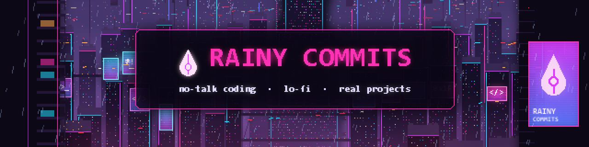

### No talking. Just code, rain and lo-fi. ☔

Every video builds a real, working project from an empty file, step by step, in a rainy pixel-art city.
Every project here is run and tested before it is published.

**▶ Watch on YouTube: [@rainycommits](https://www.youtube.com/@rainycommits)**

---

#### 🎮 Python from Zero — through games
Learn Python from your very first line of code to **your own small online RPG**.
One lesson at a time, every lesson grows the same game.
→ [python-from-zero](https://github.com/rainycommits/python-from-zero)

#### 🌧️ Rainy Builds
Free projects, from an empty file to a working app: Game of Life, terminal animations, little tools.

#### ⚡ Shorts
A new tiny Python build almost every day: digital rain, ripples, a neon city in the terminal.

---

Original pixel art and code by Rainy Commits · music from the YouTube Audio Library
